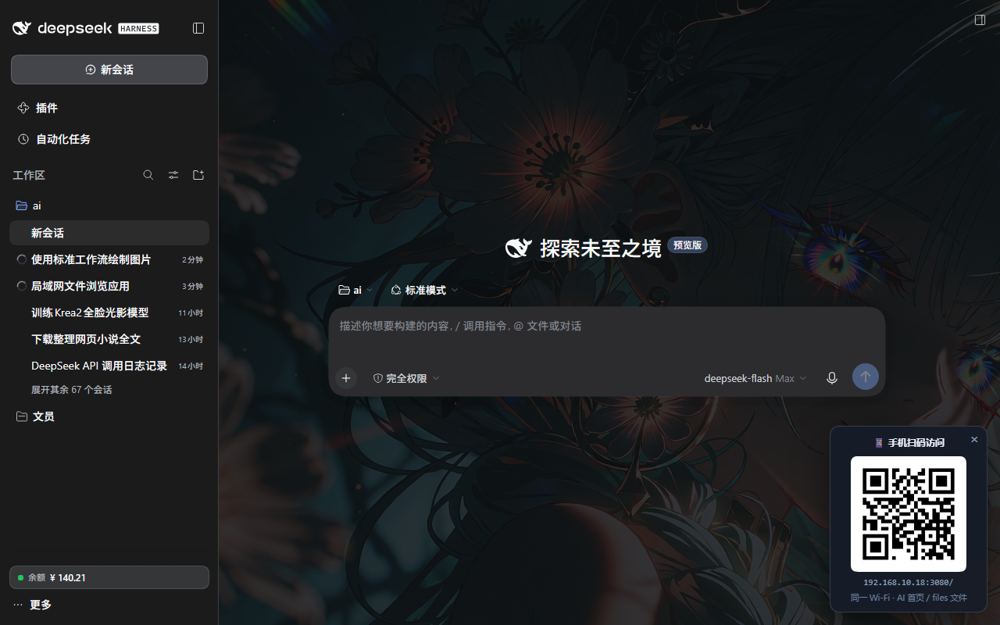
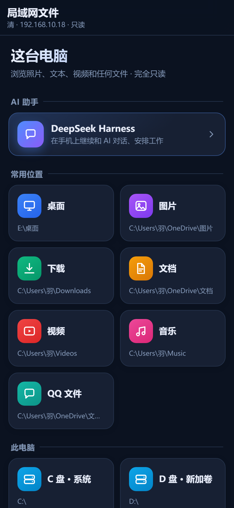
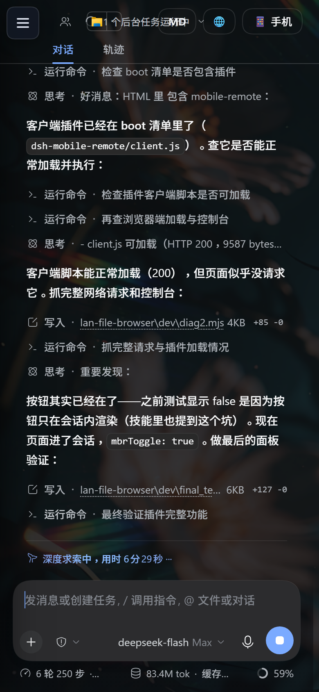

# dsh-mobile-remote · 手机远程访问

> 用手机浏览器访问电脑上的 **DeepSeek Harness**：文件浏览 + AI 对话，**同一个端口**，扫码即用。

<p align="center">
  
</p>

**作者：AURORAL-极光实验室** · 联系：**1907927628@qq.com** · 许可：MIT

---

## 🚀 最傻瓜安装（推荐）

### 方式 0：把项目丢给 DeepSeek Harness，让它自己装 ⭐⭐⭐⭐⭐

**你不需要懂任何命令。** 只需要做两件事：

**第 1 步**：复制下面这段话 👇

```
请帮我安装这个 DSH 插件（手机远程访问：文件浏览 + AI 对话）：
https://github.com/AURORAL793/dsh-mobile-remote

请按仓库 README 自动完成安装：
1. 克隆仓库到本地
2. 用 scripts/install.ps1 安装到我的 DSH（自动检测 DSH_HOME；如果装不了便携 Python 就跳过）
3. 确认插件加载成功（检查 /dsh-mobile-remote/info 返回 running:true）
4. 把手机扫码访问地址告诉我，并说明怎么用
```

**第 2 步**：打开你电脑上的 **DeepSeek Harness**（DSH），把上面这段粘贴发送。

**然后就没你什么事了**——DSH 会自动克隆、安装、配置、验证，最后把手机访问地址告诉你。

---

### 方式 1：双击安装（有手就会）

1. 下载本仓库（点右上角 `Code` → `Download ZIP`，解压）
2. **双击 `install.bat`**
3. 如果提示找不到 DSH 数据目录，按提示粘贴路径（比如 `F:\deepseekai\data`）
4. 问你要不要下载便携 Python 直接回车（推荐）
5. 重启 DSH，右下角出现二维码 → 手机扫

### 方式 2：手动安装（给折腾党）

见下方 [安装](#安装完全自包含结构) 章节。

---

## 这是什么

一个 DeepSeek Harness（DSH）插件。启用后，DSH 会在**局域网地址的同端口**上再开一个入口，
手机连同一个 Wi-Fi 就能用：

| 路径 | 内容 |
|---|---|
| `/files/` | **文件浏览首页**：照片缩略图、全屏看图、文本（自动识别 GBK/UTF-16）、视频、下载 |
| `/` | **AI 对话**：DSH 手机自适应界面（覆盖式会话抽屉、全宽聊天区、安全区适配） |
| `/dsh-mobile-remote/qr.svg` | 二维码（同源，供浮层与面板使用） |

**扫码链路**：

```
电脑端 DSH 右下角浮层扫码
   ↓
/files/  文件浏览（照片 / 文本 / 视频 / 下载）
   ↓  点「AI 助手」卡片
  /      DSH 对话（手机界面）
   ↓  点右上角「📁 文件」
/files/  随时来回切
```

<p align="center">
  
  
</p>

---

## 特性

- **同端口**：不用记两个地址——DSH 的 `3080` 就是文件 + AI 的入口
- **扫码进门**：电脑端右下角自动出现二维码浮层（手机 UA 自动隐藏）
- **手机 UI 优化**：侧边栏改覆盖式抽屉、聊天区全宽、16px 输入框（防 iOS 缩放）、底部安全区
- **文件能力**：缩略图（Pillow）、图片预览缩放、文本编码识别、视频 Range 播放、下载
- **双向切换**：文件页 ↔ AI 对话页各有一键入口
- **认证自动处理**：插件从 DSH 进程内取 launchToken 换 cookie，手机端无需 token
- **开箱即用**：自带便携 Python（可选下载），目标机**无需安装 Python**

---

## 快速开始（Windows）

### 方式一：一键安装脚本

1. 克隆 / 下载本仓库
2. 双击 `install.bat`
3. 按提示输入 DSH 数据目录（或设好 `DSH_HOME` 环境变量）
4. 重启 DSH（或等 Cordis 热加载）
5. 电脑端 DSH 右下角出现二维码 → 手机扫码

> 安装脚本会：复制插件到 `profiles/web/plugins/`、往 `cordis.patch.yml` 登记、
> 可选择性下载便携 Python（Pillow + qrcode）。

### 方式二：手动安装

把 `src/` 下的文件复制到 DSH 的 profile 插件目录：

```
<DSH_HOME>/profiles/web/plugins/
├─ mobile-remote.mjs               ← src/mobile-remote.mjs
├─ mobile-remote-qr.mjs            ← src/mobile-remote-qr.mjs
└─ mobile-remote-assets/           ← src/assets/ 的内容
   ├─ server.py
   ├─ mobile.js
   └─ web/
```

在 `<DSH_HOME>/profiles/web/cordis.patch.yml` 末尾追加：

```yaml
- insert:
    - id: mobile-remote
      name: ./plugins/mobile-remote.mjs
      config:
        port: 0          # 0 = 与 DSH 同端口
        bindHost: ""     # 空 = 自动检测局域网 IP
        filesPort: 8789  # 内部文件服务端口（仅本机）
        enabled: true
- insert:
    - id: mobile-remote-qr
      name: ./plugins/mobile-remote-qr.mjs
```

然后安装文件服务依赖（二选一）：

```powershell
# A. 用系统 Python（需要自己装）
pip install Pillow qrcode pypng

# B. 下载便携 Python 到插件目录（推荐，免安装）
.\scripts\fetch-python.ps1
```

---

## 使用

1. 电脑打开 DSH Web GUI（任意页面）
2. **右下角**「📱 手机扫码」浮层 → 手机扫码
3. 进入 `/files/` 文件浏览首页
4. 点「AI 助手」卡片进对话；对话页右上角「📁 文件」回文件浏览

手机端界面自动适配：

- 左上角浮动 **☰**（覆盖式会话抽屉，点遮罩收起）
- 右上角 **📁 文件**（回文件浏览）
- 输入框 16px、底部安全区、隐藏桌面专属控件

---

## 配置

`cordis.patch.yml` 里 `mobile-remote` 的 `config`：

| 字段 | 默认 | 说明 |
|---|---|---|
| `port` | `0` | 对外端口；0 = 与 DSH 同端口 |
| `bindHost` | `""` | 绑定地址；空 = 自动取第一个局域网 IPv4 |
| `filesPort` | `8789` | 内部文件服务端口（只监听 127.0.0.1） |
| `enabled` | `true` | 是否启用 |

环境变量：

- `PYTHON`：强制指定 Python 解释器路径（默认优先用插件内置 `python/python.exe`）

---

## 安全说明

- 插件绑定的是**局域网地址**，不对公网暴露
- 但同一 Wi-Fi 下任何设备都能打开——**DSH 是完全权限的 AI，请勿在不可信网络使用**
- 需要严格管控时，建议配合 DSH 自身的 `--trusted-host` 或网关层做访问控制

---

## 常见问题

**Q：手机打不开？**
1. 手机和电脑是否同一 Wi-Fi
2. 电脑防火墙是否放行（第一次启动会弹窗，需允许 Node → 入站）
3. 检查 DSH 控制台是否有 `[mobile-remote] 启动失败`

**Q：右下角没有二维码？**
- 刷新页面（`Ctrl+F5`）；浮层由独立插件注入 index
- 或检查 patch 里 `mobile-remote-qr` 条目是否存在

**Q：没有缩略图 / 二维码不显示？**
- 缺少 Pillow / qrcode：运行 `scripts\fetch-python.ps1` 安装便携 Python

**Q：插件加载了但服务没起？**
- 看 `<plugins>/mobile-remote.log`（插件执行日志）
- 日志里没有 `apply called` = 插件没被 Cordis 调用，检查 `export default { name, inject, apply }` 是否存在

---

## 技术原理

### 为什么能和 DSH 同端口

DSH 的 webserver 明确拒绝绑定 `0.0.0.0`（安全设计），只绑 `127.0.0.1:<port>`。
本插件绑定 **`<局域网IP>:<port>`**——同一端口的不同地址在操作系统层面互不冲突：

```
127.0.0.1:3080      ← DSH 自己（本机浏览器）
192.168.10.18:3080  ← 本插件（手机访问，反代到 127.0.0.1:3080）
```

### 认证

插件运行在 DSH 进程内，向 `connection` 服务取 `browserAuth.launchToken`，
换成本机 cookie 后注入反代请求；失败时回退浏览器历史 token。手机端完全无感。

### 文件服务

`assets/server.py`（Python + Pillow）只监听 `127.0.0.1:8789`，
插件把 `/files/*` 反代过去，`/fapi/*` 重写为 `/api/*`。手机端零感知。

### 目录结构

```
src/
├─ mobile-remote.mjs        宿主：对外服务、DSH 反代、文件服务托管、cookie 管理
├─ mobile-remote-qr.mjs     扫码浮层：index 注入 + 二维码路由
└─ assets/
   ├─ server.py             文件服务（Python，127.0.0.1:8789）
   ├─ mobile.js             DSH 手机端 UI 注入脚本
   └─ web/                  文件浏览前端
scripts/
├─ install.ps1              安装逻辑
├─ uninstall.ps1            卸载逻辑
└─ fetch-python.ps1         下载便携 Python（Python 3.11 embeddable + Pillow + qrcode）
```

### 关键坑（给二次开发者）

> Cordis loader 对 `plugins/` 下的**单文件 `.mjs` 插件只认 `export default`**。
> 只有 named exports（`export function apply`）时模块能 import 但 `apply` 不会被调用——
> 表现为"插件配置在、但服务没起"。本插件宿主同时导出 default 与 named 以兼容两种加载方式。

---

## 许可

MIT License · Copyright (c) 2026 AURORAL-极光实验室

联系：**1907927628@qq.com**
